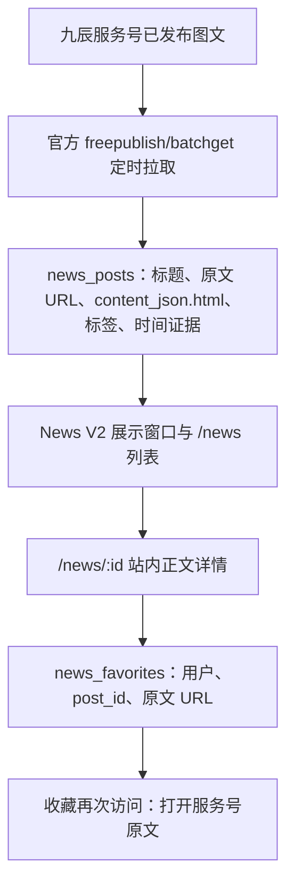

# 资讯链路拓扑复核与首发判定（2026-10-18）

本页以用户确认的业务目标为准：九辰服务号内容进入其小程序；图文在小程序**完整阅读**；进阶收藏保存服务号**原文链接**，从收藏再次访问原文时允许离开小程序。视频可只提供原文链接。此页是代码审查与下一轮验证定义，不代表修复或生产验收已完成。

## 实际拓扑

当前不是服务号主动推送到小程序，而是 `jiuchen-news-sync.timer` 定时**拉取**。列表筛选、展示窗口、正文渲染和收藏是后续独立环节；任何一环通过不能代替整条链路通过。

| 环节 | 固定候选源码 | 首发所需证据 |
| --- | --- | --- |
| 来源 | `official-account.ts` 仅调用 `freepublish/batchget`，以 `article_id:index` 作为来源键；完整 45/45 组扫描仍缺已知 10 月目标 | 用四个运营提供的短链接及 10 月 12 日目标对照后台、接口返回和账号归属；查漏文的来源边界，不能用“全量分页”冒充文章全覆盖 |
| 入库 | `news.ts` 存 `content_json.html`、URL 与标签；来源同步错误／截断时不调和 V2 窗口 | 文章标题、正文、原文 URL 一一对应；重复同步不会覆盖有用正文为空或造重复稿 |
| 展示 | 无标签不公开；V2 还要求 `news_display_states` 中正常／缓冲态；约 30 条正常窗口、超出旧内容缓冲 72 小时 | 指定近期真实图文实际进入公开窗口，早期内容的出入与分类可解释；不能批量标产品资料假装修好新稿 |
| 站内阅读 | `news-detail.ts` 把 `content.html` 转成安全 `rich-text`；无正文时 WXML 提示并让用户打开原文；视频单独跳原文 | 真机逐篇打开图文正文、图片和长页；点击卡片仍在小程序内 |
| 收藏 | `PUT /me/news-favorites/:id` 仅允许 active、官方来源、已分类且在 normal/buffering 的文章；保存 `post_id`、标题和原文 URL；收藏入口打开原文 | 同一用户收藏幂等、跨用户隔离、退场后收藏仍保有原链接；真机原文打开 |

## 结构性断点

1. **单一来源视图不等于服务号全部文章。** 当前官方列表 45/45 组说明分页完成，不说明与运营后台已发布内容相等。八条产品资料和一条保研问答的 10 月更新时间不等于 10 月新稿收齐；10 月 12 日目标未在库。接口漏取的具体原因尚未验证，不能先宣称是发布方式、权限或月份限制。
2. **当前 URL 补录是“索引卡”，不是“站内文章”。** `POST /me/admin/news/verified-official` 强制发表时间，并插入 `html:null`。图文详情因无正文只能提示“暂无站内正文”并打开服务号原文，直接违背此次首发目标。四条运营短链仅作为定位与原文锚点，不能被标为图文阅读 PASS。
3. **时间不是收录的核心条件。** `news_posts.published_at` 可空；旧记录曾错把 `update_time` 放入发表时间。日期未知应明确显示待核，排序可以使用独立的入库时间，但必须与发表时间分开；不能凭空补日期。
4. **展示与收藏依赖内容之外的门槛。** 给没有正文的稿打标签并调和窗口，只能让链接卡出现在列表；收藏虽然可以保存原文 URL，无法弥补图文正文缺失。空时间稿若沿用现有 V2 排序还可能落到尾部，故排序语义也要一起验。
5. **来源与正文更新要防倒退。** 自动 upsert 当前会整体替换 `contentJson`。在来源返回缺正文但标题等字段改变时，已有站内正文可能被空值覆盖；须保护已保存正文，除非明确撤稿或经审查替换。

## 上游只读定位结果（2026-10-18 15:07）

[固定候选来源对照脚本](../../ops/ecs/news-source-diff-readonly-20261018.mjs) SHA-256 `43a010637b8ff6f528398943dd05964874d4c7286475c3f8b91544d7476cfff8` 已由管理员在 ECS staging 验证脚本校验值并运行。`PROBE_STEP=STAGING_ACCESS` 与 `STAGING_ACCESS_PASS`；独立 systemd unit `jiuchen-news-source-probe-20261018150737.service` success/status 0。输出为 `READ_ONLY_SOURCE_AND_DATABASE_DIFF`、固定候选 `1b8ae8b3...`、账号 AppID 后四位 `80db`、45/45 来源组与 46 篇、旧稿对照命中。四条运营短链和“中南大学”标题在来源与生产库均零命中；只读事务、`productionWrites=false`，没有访问文章网页。

这证明当前账号配置与当前官方列表的**源端覆盖缺口**，不证明服务号根本没有发表这些文章，也不证明根因是账号错配或发布路径不同。短链与长链可能不同，脚本也执行了标题近似对照，仍无命中。下一项最短人工核查：登录实际发表上述文章的服务号后台，在开发者基本配置查看 AppID **仅后四位**是否 `80db`；同时查看旧 9 月命中稿与一篇 10 月新稿所在的发布/群发后台记录路径，并记录面包屑或截图（遮住密钥）。本次账号后四位已确认相同，账号错配已排除；后台截图进一步确认贴图类型是至少一篇缺失稿的直接差异。其余稿件需按后台类型与发布路径核对，再确定受支持的第二来源或后台正文/图片导入方案。不得因这次零命中而将链接卡当正文验收。
## 同账号后台形态证据（15:45）

用户确认实际服务号 AppID 后四位 `80db`，与生产探针一致。后台六张截图：发表记录「全部」64 次，「文章」46 次，「贴图」18 篇；贴图列表可见 10 月 12 日《10月竞赛清单来啦～》和 10 月 10 日《最清晰的保研思路》，表明至少一条运营指定的漏稿属于**贴图**。普通文章条目又提示「已自动将文章生成为贴图草稿」，文章与贴图可能有同主题的两个独立实体，不能按标题去重或认为贴图草稿已发表。后台「已发表」状态与 API 可见性不是同一概念。其余三条运营短链及「中南大学」稿不在截图可见范围，尚不能归为贴图。

当前 `official-account.ts` 唯一来源是 `/cgi-bin/freepublish/batchget`，读取 `content.news_item` 的文章 HTML；没有贴图来源模型、已发表图片清单及小程序图片序列阅读。接口 45 个组/46 个子文章与后台「文章 46 次」计量单位不同，数字接近不证明文章已经全部收录。应按稳定内容 ID、类型、状态与原文 URL 做差集，分别核普通文章与贴图；另查新稿是否通过当前接口不覆盖的发表路径。现有证据不支持将五条漏稿全部归因于贴图，也不支持再把 AppID 错配作为主线。

| 形态 | 站内交付合同 | 收藏行为 | 待实现来源 |
| --- | --- | --- | --- |
| 普通图文文章 | 标题、完整 HTML 与图片在小程序内阅读 | 保存原文 URL，收藏后可打开原文 | 当前接口已覆盖部分；查遗漏发表路径 |
| 已发表贴图 | 标题、按顺序展示的图片组及说明在小程序内阅读 | 保存该贴图原文 URL | 优先核微信支持的已发表贴图接口与返回合同；若不开放，运营后台导出原始图片和元数据后经管理员核实导入 |
| 视频 | 列表信息和原文跳转 | 保存原文 URL | 按实际官方来源核定 |

修复包包含：来源适配、统一入库类型/稳定去重、图片组站内阅读、自动同步不覆盖人工核实正文、可空发表时间、真实目标文章的列表/详情/收藏端到端验证。与客服、四角色、充值和统计一起打包做兼容性验收；新候选需重新冻结 SHA 和跑相关 Gate。不得从文章网页或私有后台接口绕过访问限制抓取内容，未取得可用来源时保留经核实的后台原始素材导入路径。

## 决策与最小闭环

- 保留 `news_posts` 为唯一文章真相源；继续用官方发布列表作首选获取渠道，不为每篇新增单独页面。建立一个**统一入库合同**：身份／归属证据、稳定原文 URL、标题、可选时间、正文或视频类型、来源状态、标签、正文完整性。所有来源进入同一去重、内容检查、展示窗口与收藏链路。
- 对官方接口返回完整正文的图文，沿用现有站内阅读通路；对四个短链若接口确实缺失，先找九辰可控制的**原始编辑内容或服务号后台可导出的正文**，经管理员核对后结构化导入 `content_json.html`。这属于运营辅助补源，须保留原文 URL 与 provenance，不等于自动同步恢复。没有取得可核正文的图文不计站内阅读 PASS，也不把 URL 卡当成完成；视频依用户要求允许链接。
- 来源修复优先做**差异探针**：只读输出运营给定 URL／标题在官方返回中的命中、在库中的命中、是否有正文、分类及公开窗口状态；不得输出密钥或全部文章内容。结合后台实际发布记录再决定是否有第二种受支持的来源接口或账号配置错误。暂不假定微信有可用的发布回调、其他接口或任意网页抓取权。
- 发版前以一组真实文章跑完整闭环：至少两篇图文在小程序内可阅读正文（含图）、收藏后从收藏打开对应原文；一篇视频按链接打开；旧文章与四角色/客服不回归。缺任一篇真实图文正文，就如实标阻断。仅修发表时间表单不解决这一核心问题。

## 本轮实现与待验（2026-10-18）

`p1/foundation` 已实现统一的管理员核实入库入口：图文可按行交错存文字与微信图片链接，贴图须有至少一张图片，视频仍只跳原文；发布时间可空，按导入时间参与窗口排序但不显示为发表时间。服务端严格校验管理员身份、服务号原文 URL 和微信图片域名；小程序详情依序呈现文字/图片并支持图片预览，收藏仍保存原文链接。官方图文同步如后来返回同 URL，可复用核实记录 ID；官方无正文时保留核实的图片组和时间证据。初次补录须同时检查该内容确在服务号后台发表，核对完整原始素材。

当地镜像验证：API 以 Node v22.23.3 完成 typecheck/build、215/215 测试，小程序 typecheck 与两条阅读回归 PASS。仍无自托管工作流回执；微信图片域名加载、真实管理员补录、站内详情与收藏在新体验版上均未验。图片原始素材未导出，四条链接未写生产数据。官方贴图自动列举接口没有可验证的返回合同，此轮没有接入猜测接口；自动同步缺口仍在。若后续得到官方接口与实际返回，再加第二来源并按同一合同去重。全导航在不含二进制图标的当地镜像中 53/54，缺图标报 ENOENT，不宣称全绿。

**变更边界：** 固定前端 `283aaf15` 与 API `1b8ae8b3` 仍是上一轮已验候选，不含本轮代码。本轮分支 HEAD 应重新读取并固定新的发布候选 SHA；生产 `8cc4bb85`、已批准的 DDL、微信体验版均未因此改变。Node 22 Gate、ECS staging、运营真实素材导入与真机站内阅读是下一次实际验收。
