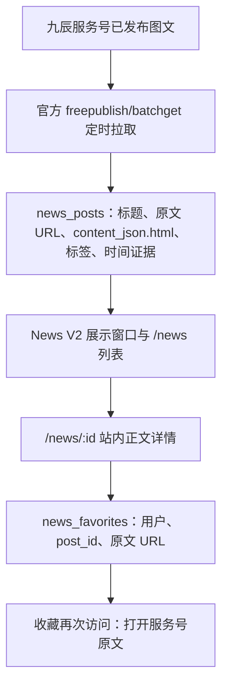

# 资讯链路拓扑复核与首发判定（2026-10-18）

本页以用户确认的业务目标为准：九辰服务号内容进入其小程序；图文在小程序**完整阅读**；进阶收藏保存服务号**原文链接**，从收藏再次访问原文时允许离开小程序。视频可只提供原文链接。此页是代码审查与下一轮验证定义，不代表修复或生产验收已完成。

## 实际拓扑

当前不是服务号主动推送到小程序，而是 `jiuchen-news-sync.timer` 定时**拉取**。列表筛选、展示窗口、正文渲染和收藏是后续独立环节；任何一环通过不能代替整条链路通过。

| 环节 | 固定候选源码 | 首发所需证据 |
| --- | --- | --- |
| 来源 | `official-account.ts` 仅调用 `freepublish/batchget`，以 `article_id:index` 作为来源键；完整 45/45 组扫描仍缺已知 10 月目标 | 用四个运营提供的短链接及 10 月 12 日目标对照后台、接口返回和账号归属；查漏文的来源边界，不能用“全量分页”冒充文章全覆盖 |
| 入库 | `news.ts` 存 `content_json.html`、URL 与标签；来源同步错误／截断时不调和 V2 窗口 | 文章标题、正文、原文 URL 一一对应；重复同步不会覆盖有用正文为空或造重复稿 |
| 展示 | 无标签不公开；V2 还要求 `news_display_states` 中正常／缓冲态；约 30 条正常窗口、超出旧内容缓冲 72 小时 | 指定近期真实图文实际进入公开窗口，早期内容的出入与分类可解释；不能批量标产品资料假装修好新稿 |
| 站内阅读 | `news-detail.ts` 把 `content.html` 转成安全 `rich-text`；无正文时 WXML 提示并让用户打开原文；视频单独跳原文 | 真机逐篇打开图文正文、图片和长页；点击卡片仍在小程序内 |
| 收藏 | `PUT /me/news-favorites/:id` 仅允许 active、官方来源、已分类且在 normal/buffering 的文章；保存 `post_id`、标题和原文 URL；收藏入口打开原文 | 同一用户收藏幂等、跨用户隔离、退场后收藏仍保有原链接；真机原文打开 |

## 结构性断点

1. **单一来源视图不等于服务号全部文章。** 当前官方列表 45/45 组说明分页完成，不说明与运营后台已发布内容相等。八条产品资料和一条保研问答的 10 月更新时间不等于 10 月新稿收齐；10 月 12 日目标未在库。接口漏取的具体原因尚未验证，不能先宣称是发布方式、权限或月份限制。
2. **当前 URL 补录是“索引卡”，不是“站内文章”。** `POST /me/admin/news/verified-official` 强制发表时间，并插入 `html:null`。图文详情因无正文只能提示“暂无站内正文”并打开服务号原文，直接违背此次首发目标。四条运营短链仅作为定位与原文锚点，不能被标为图文阅读 PASS。
3. **时间不是收录的核心条件。** `news_posts.published_at` 可空；旧记录曾错把 `update_time` 放入发表时间。日期未知应明确显示待核，排序可以使用独立的入库时间，但必须与发表时间分开；不能凭空补日期。
4. **展示与收藏依赖内容之外的门槛。** 给没有正文的稿打标签并调和窗口，只能让链接卡出现在列表；收藏虽然可以保存原文 URL，无法弥补图文正文缺失。空时间稿若沿用现有 V2 排序还可能落到尾部，故排序语义也要一起验。
5. **来源与正文更新要防倒退。** 自动 upsert 当前会整体替换 `contentJson`。在来源返回缺正文但标题等字段改变时，已有站内正文可能被空值覆盖；须保护已保存正文，除非明确撤稿或经审查替换。

## 决策与最小闭环

- 保留 `news_posts` 为唯一文章真相源；继续用官方发布列表作首选获取渠道，不为每篇新增单独页面。建立一个**统一入库合同**：身份／归属证据、稳定原文 URL、标题、可选时间、正文或视频类型、来源状态、标签、正文完整性。所有来源进入同一去重、内容检查、展示窗口与收藏链路。
- 对官方接口返回完整正文的图文，沿用现有站内阅读通路；对四个短链若接口确实缺失，先找九辰可控制的**原始编辑内容或服务号后台可导出的正文**，经管理员核对后结构化导入 `content_json.html`。这属于运营辅助补源，须保留原文 URL 与 provenance，不等于自动同步恢复。没有取得可核正文的图文不计站内阅读 PASS，也不把 URL 卡当成完成；视频依用户要求允许链接。
- 来源修复优先做**差异探针**：只读输出运营给定 URL／标题在官方返回中的命中、在库中的命中、是否有正文、分类及公开窗口状态；不得输出密钥或全部文章内容。结合后台实际发布记录再决定是否有第二种受支持的来源接口或账号配置错误。暂不假定微信有可用的发布回调、其他接口或任意网页抓取权。
- 发版前以一组真实文章跑完整闭环：至少两篇图文在小程序内可阅读正文（含图）、收藏后从收藏打开对应原文；一篇视频按链接打开；旧文章与四角色/客服不回归。缺任一篇真实图文正文，就如实标阻断。仅修发表时间表单不解决这一核心问题。

**变更边界：** 当前固定前端 `283aaf15` 与 API `1b8ae8b3` 对这四个短链的站内正文还没有通过。若采用统一入库合同、正文保护或排序修复，必须形成新候选 SHA 并复验相关 News 门禁、ECS 与真机；现役生产和已批准的 DDL 不因此被改写。
